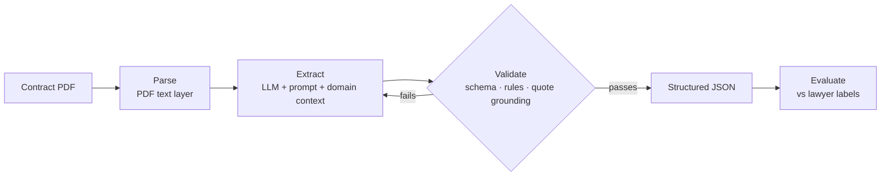

# Document Intelligence Engine

**LLM clause extraction from commercial contracts, measured against lawyer labels.**

Turns a contract into validated JSON for 12 key clauses (parties, dates, governing law, renewal, termination, assignment, liability cap, non-compete), with a verbatim quote as evidence for every answer. Accuracy is measured with precision and recall against 13,000+ lawyer-highlighted passages from the [CUAD](https://www.atticusprojectai.org/cuad) dataset.

> 🚧 **Work in progress.** Evaluation, extraction and prompt engineering are done and measured (below). Next: the end-to-end workflow, i.e. PDF input, review flags and a review UI. Planned items are listed separately under [Roadmap](#roadmap).

## Results so far

**80 dev contracts not used for prompt tuning** (the honest dev numbers):

| System | Span precision | Span recall | Span F1 | Presence accuracy | Cost / contract |
|---|---:|---:|---:|---:|---:|
| Claude Haiku 5.5, prompt v1 (plain) | 52.8% | 35.9% | 42.7% | 91.1% | $0.004 |
| Claude Haiku 5.5, prompt v2b (final) | 79.9% | 77.1% | **78.4%** | 93.8% | $0.005 |

**Prompt development** on 20 dev contracts, adding one change at a time:

| System | Span F1 |
|---|---:|
| Keyword baseline (no LLM) | 29.4% |
| Prompt v1: plain CUAD definitions | 51.4% |
| v2a: + quoting rules | 84.0% |
| v2b: + field definitions with exclusions | 86.7% |

Both prompts score ~8 points lower on the 80 fresh contracts than on the 20 tuning ones, and the v1 → v2b gain holds (+35). So the fresh contracts are harder, and the prompt improvements generalise rather than overfit. Run summaries are in [results/](results/). Final numbers will be reported once, on 95 held-out test contracts.

## Key findings so far

- **No OCR or vision model needed for these documents.** All 510 PDFs have a text layer. Plain text extraction keeps 98.1% of the 7,032 lawyer passages for our 12 fields word for word, at ~1 s and $0 per contract; the rest differ only in small details such as superscript ordinals split by the PDF ("1st" → "1 st").
- **Most first-prompt "errors" were labelling conventions, not misunderstanding.** Lawyers highlight only the name or date for parties and dates, but whole sentences for clauses. Teaching the model that rule raised F1 from 51.4% to 84.0% (Parties 25.9% → 92.7%).
- **The remaining errors were neighbouring clause types.** All Non-Compete false alarms were non-solicitation or exclusivity clauses, which CUAD labels as separate categories. Naming those exclusions in the definition raised Non-Compete precision from 35% to 60% with recall unchanged, and cut false alarms overall from 17 to 8.
- **Keywords can't interpret.** The baseline raised 152 false Non-Compete alarms and missed clauses like *"shall not run banner advertisements for any of 2TheMart's competitors"*. Telling those apart is the job the LLM has to earn its cost on.

## How it works



Every field returns three things:

```json
"governing_law": {
  "present": true,
  "evidence": ["This Agreement will be governed and construed in accordance with the laws of the State of California ..."],
  "value": "California"
}
```

- **Validation** has three layers: the JSON structure is enforced by the API; Pydantic rules check meaning (e.g. `present` requires evidence, dates must be real ISO dates); and every quote must actually appear in the contract, which blocks invented evidence.
- **Scoring**: a predicted passage counts as correct when it overlaps a lawyer's highlight by ≥ 50% (word-set Jaccard, as in the CUAD paper). Each field in each contract also gets an error label: missed, false alarm, boundary (right place, wrong extent) or wrong passage.

Design decisions and the evidence behind each are in [docs/decisions.md](docs/decisions.md).

## Run it

```bash
git clone https://github.com/harikrishnanr96/document-intelligence-engine.git
cd document-intelligence-engine
pip install -e ".[dev]"

python scripts/download_data.py      # fetches CUAD (~106 MB) into data/raw/
pytest                               # no dataset or API key needed
python scripts/run_baseline.py       # scores the keyword baseline on the dev set

# LLM extraction: put ANTHROPIC_API_KEY=... in a .env file first (it is git-ignored)
python scripts/run_extraction.py --n 100 --exclude-sample 20 --prompt v2b   # 80 contracts, ~$0.40 on Claude Haiku 5.5
```

## Roadmap

- [x] Ground-truth loader, deterministic dev/test split
- [x] Pydantic schema and three-layer validation
- [x] Eval harness (span precision/recall, presence accuracy, error types) and keyword baseline
- [x] First LLM extraction (Haiku 5.5, prompt v1: F1 51.4% vs 29.4% keyword baseline on 20 dev contracts, $0.003 / contract)
- [x] Prompt and context engineering: v1 → v2a → v2b ablation, confirmed on 80 contracts not used for tuning (F1 42.7 → 78.4)
- [ ] `docintel extract contract.pdf`: PDF in, validated JSON out, with text-layer and "is this a contract?" checks
- [ ] Review flags: mark each result auto-accept or needs-review, and measure whether flagged items contain most errors
- [ ] Batch extraction over a folder into one results table
- [ ] Review UI: queue of flagged results with evidence highlighted in the contract
- [ ] One model comparison: Haiku vs a stronger model on the same contracts
- [ ] Final score on the 95 held-out test contracts, run once
- [ ] Demo and write-up

## Out of scope (for now)

- **OCR and vision models.** Every CUAD PDF has a text layer that preserves 99.9% of labelled evidence, so these documents don't need them. Scanned documents would.
- **Self-hosted models.** Planned as a separate follow-up project on inference engineering (serving, quantization, LoRA fine-tuning) that reuses this eval as its quality benchmark.

## Data and licence

Code: MIT. Data: [CUAD v1](https://www.atticusprojectai.org/cuad) by The Atticus Project, CC BY 4.0 ([paper](https://arxiv.org/abs/2103.06268)). The dataset isn't stored in this repo; `scripts/download_data.py` fetches it.
