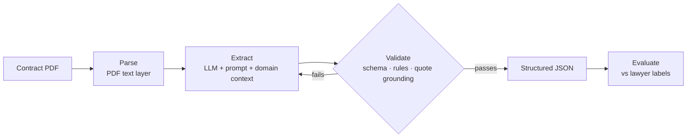

# Document Intelligence Engine

**LLM clause extraction from commercial contracts, measured against lawyer labels.**

Turns a contract into validated JSON for 12 key clauses (parties, dates, governing law, renewal, termination, assignment, liability cap, non-compete), with a verbatim quote as evidence for every answer. Accuracy is measured with precision and recall against 13,000+ lawyer-highlighted passages from the [CUAD](https://www.atticusprojectai.org/cuad) dataset.

> 🚧 **Work in progress.** Evaluation harness, baseline and LLM extraction are working; prompt engineering is in progress.

## Results so far (20 dev contracts, same sample for every row)

| System | Span precision | Span recall | Span F1 | Presence accuracy | Cost / contract |
|---|---:|---:|---:|---:|---:|
| Keyword baseline (no LLM) | 30.5% | 28.4% | 29.4% | 80.8% | $0 |
| Claude Haiku 5.5, prompt v1 (plain) | 59.0% | 45.6% | 51.4% | 92.5% | $0.003 |
| Claude Haiku 5.5, prompt v2a (+ quoting rules) | 81.3% | 87.0% | 84.0% | 91.2% | $0.004 |

Run summaries are in [results/](results/). Final numbers will be reported once, on 95 held-out test contracts.

## Key findings so far

- **No OCR or vision model needed for these documents.** All 510 PDFs have a text layer, and plain text extraction preserved 99.9% (2,261 / 2,263) of the lawyer-labelled passages, at ~0.2 s and $0 per contract.
- **Most first-prompt "errors" were labelling conventions, not misunderstanding.** Lawyers highlight only the name or date for parties and dates, but whole sentences for clauses. Teaching the model that rule raised F1 from 51.4% to 84.0% (Parties 25.9% → 92.7%).
- **The remaining errors are neighbouring clause types.** All Non-Compete false alarms were non-solicitation or exclusivity clauses, which CUAD labels as separate categories.
- **Keywords can't interpret.** The baseline raised 152 false Non-Compete alarms and missed clauses like *"shall not run banner advertisements for any of 2TheMart's competitors"*. Telling those apart is the job the LLM has to earn its cost on.

## How it works



Every field returns three things:

```json
"governing_law": {
  "present": true,
  "evidence": ["This Agreement will be governed and construed in accordance with the laws of the State of California ..."],
  "value": "California"
}
```

- **Validation** has three layers: the JSON structure is enforced by the API; Pydantic rules check meaning (e.g. `present` requires evidence, dates must be real ISO dates); and every quote must actually appear in the contract, which blocks invented evidence.
- **Scoring**: a predicted passage counts as correct when it overlaps a lawyer's highlight by ≥ 50% (word-set Jaccard, as in the CUAD paper). Each field in each contract also gets an error label: missed, false alarm, boundary (right place, wrong extent) or wrong passage.

Design decisions and the evidence behind each are in [docs/decisions.md](docs/decisions.md).

## Run it

```bash
git clone https://github.com/harikrishnanr96/document-intelligence-engine.git
cd document-intelligence-engine
pip install -e ".[dev]"

python scripts/download_data.py      # fetches CUAD (~106 MB) into data/raw/
pytest                               # no dataset or API key needed
python scripts/run_baseline.py       # scores the keyword baseline on the dev set

# LLM extraction: put ANTHROPIC_API_KEY=... in a .env file first (it is git-ignored)
python scripts/run_extraction.py --n 20 --prompt v2a   # ~$0.08 on Claude Haiku 5.5
```

## Roadmap

- [x] Ground-truth loader, deterministic dev/test split
- [x] Pydantic schema and three-layer validation
- [x] Eval harness (span precision/recall, presence accuracy, error types) and keyword baseline
- [x] First LLM extraction (Haiku 5.5, prompt v1: F1 51.4% vs 29.4% keyword baseline on 20 dev contracts, $0.003 / contract)
- [ ] Prompt and context engineering, with before/after scores per field
- [ ] Trade-offs on the same contracts and eval:
  - models: Haiku vs Opus (vs Sonnet), accuracy against cost and latency
  - API vs self-hosted: one open-source model served with vLLM on a cloud GPU
  - readers: PDF text layer vs OCR vs vision model on simulated scans
- [ ] `docintel extract contract.pdf` CLI with an OCR fallback for scanned PDFs
- [ ] Demo, charts and write-up

## Future work

- **LLM inference engineering (planned follow-up project):** quantization, batching, latency and fine-tuning (LoRA) of a small open-source model, using this project's eval as the quality benchmark. Question: can a small fine-tuned model match the API on these 12 fields?

## Data and licence

Code: MIT. Data: [CUAD v1](https://www.atticusprojectai.org/cuad) by The Atticus Project, CC BY 4.0 ([paper](https://arxiv.org/abs/2103.06268)). The dataset isn't stored in this repo; `scripts/download_data.py` fetches it.
